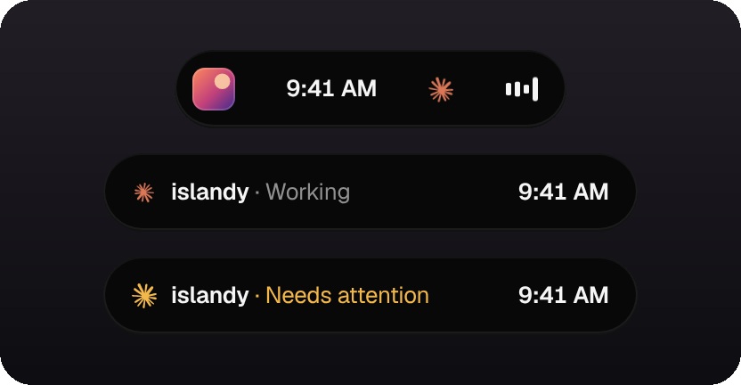
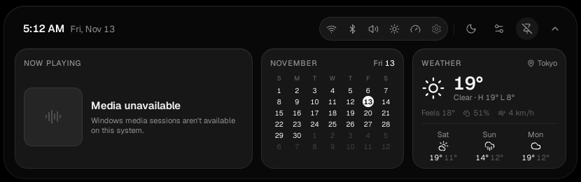
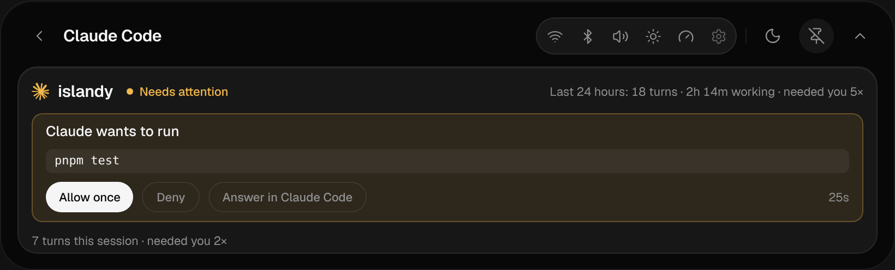
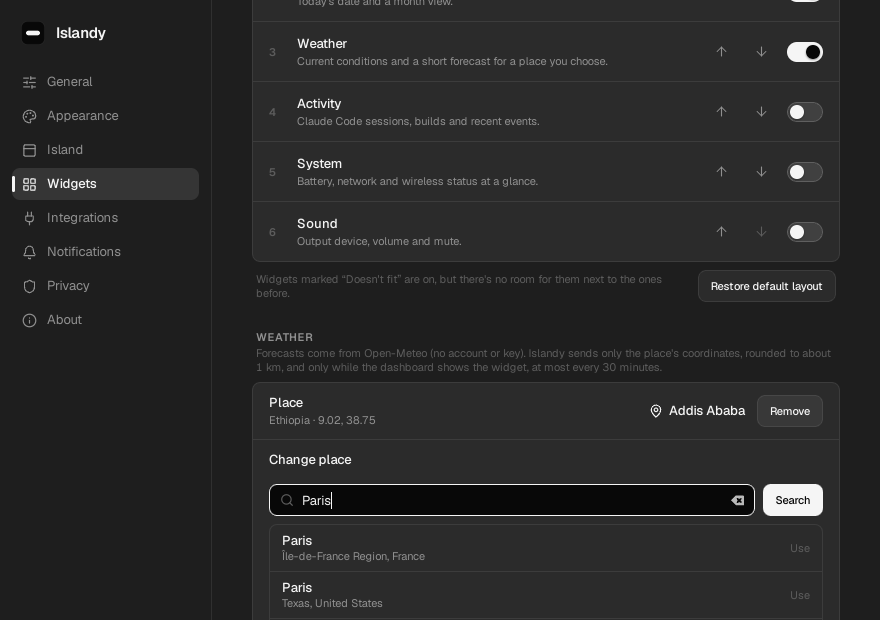
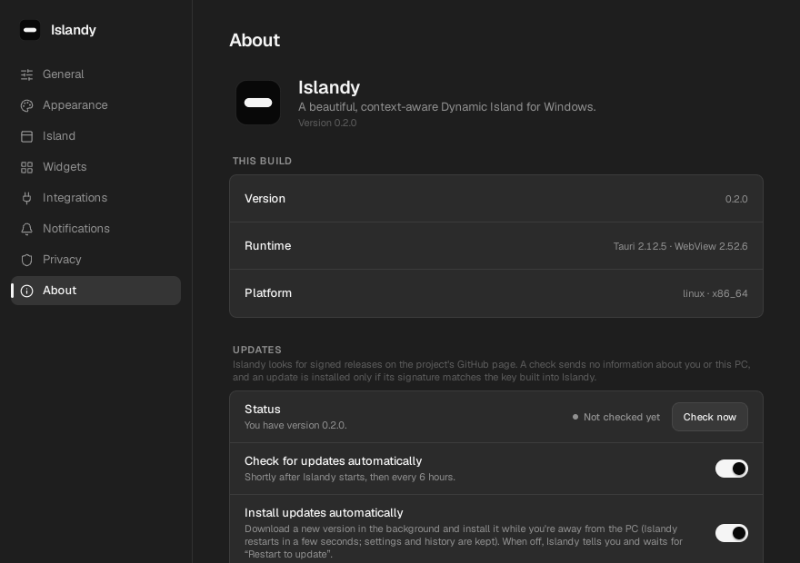

<div align="center">


# Islandy

**A beautiful, context-aware Dynamic Island for Windows.**

Music, time, calendar, weather, system status and your developer activity in one calm pill at
the top of the screen. It's local, private and light on resources.

[](https://github.com/lijnati/Islandy/releases/latest)
[](#requirements)
[](https://v2.tauri.app)
[](https://github.com/lijnati/Islandy/actions/workflows/release.yml)

[**Download**](https://github.com/lijnati/Islandy/releases/latest) ·
[Install guide](docs/installation.md) ·
[Settings](docs/settings.md) ·
[Privacy](docs/privacy.md) ·
[Troubleshooting](docs/troubleshooting.md)

<br />



<br />



</div>

---

## Why Islandy

Windows has no good place for _what's happening right now_. Islandy gives it one: a compact
island that stays out of the way. Hover it and it expands into a dashboard. When something
matters it peeks for a moment: a track change, a finished build, Claude Code waiting for you, a
low battery. It feels like part of the OS. It has no taskbar button, never steals focus, and
uses almost nothing when idle.

## Claude on the island

Claude's orange logo sits on the island between the clock and the music. It breathes slowly
while Claude is idle, turns while Claude Code (or Claude Desktop) works, and pulses amber when
Claude needs you. Click it to open the Claude panel: every session's status, permission
requests you can answer with **Allow once** / **Deny** (opt-in), and how your last 24 hours with
Claude went.



## Features

|                          |                                                                                                                                                                                                                                                          |
| ------------------------ | -------------------------------------------------------------------------------------------------------------------------------------------------------------------------------------------------------------------------------------------------------- |
| **Now Playing**          | Any app that publishes a Windows media session (Spotify, browsers, Media Player…): artwork, controls, seeking, session switching.                                                                                                                        |
| **Weather**              | Current conditions, feels-like, humidity, wind and a 3-day outlook for a place you choose, or your Windows location on request. Powered by Open-Meteo, with no account.                                                                                  |
| **Calendar**             | Locale-aware month view with navigation.                                                                                                                                                                                                                 |
| **System**               | Volume and output, battery and power, network, Wi-Fi and Bluetooth radios, display brightness, CPU and memory, plus peeks for meaningful changes.                                                                                                        |
| **Developer activity**   | Claude Code sessions (working, needs attention, finished, error) via opt-in hooks, Allow/Deny for permission requests (opt-in), a 24-hour usage glance, Claude Desktop replies in progress, and `islandy notify build failed` for any script or CI step. |
| **Make it yours**        | Midnight, Graphite and Frost themes, six accents, opacity, corners, motion; any monitor, left/center/right, offset, three sizes; reorder widgets; your own shortcut.                                                                                     |
| **Automatic updates**    | Signed releases install themselves while you're away, or with one click. You can turn it off.                                                                                                                                                            |
| **Respectful by design** | Quiet mode, per-source peek controls and rate limits, launch at startup (opt-in), auto-hide during fullscreen apps.                                                                                                                                      |

<table>
  <tr>
    <td></td>
    <td></td>
  </tr>
  <tr>
    <td align="center"><sub>Widgets: order, visibility and the weather place</sub></td>
    <td align="center"><sub>About: version and automatic updates</sub></td>
  </tr>
</table>

## Install

1. Download **`Islandy_<version>_x64-setup.exe`** from the
   [latest release](https://github.com/lijnati/Islandy/releases/latest).
2. Run it. It installs per-user, so no administrator rights are needed.
3. Islandy appears at the top of your screen. Hover it, click it, or press **Ctrl + Alt + Space**.

The installer isn't code-signed yet, so Windows SmartScreen may ask you to confirm (**More info →
Run anyway**). Details, uninstalling and the command-line tool:
[docs/installation.md](docs/installation.md).

### Requirements

- Windows 10 (1809+) or Windows 11, x64
- Microsoft Edge WebView2 Runtime (preinstalled on Windows 11; the installer fetches it if missing)

## Privacy

Islandy has **no account, no cloud service, no telemetry and no analytics**. Activity history,
settings and logs stay in `%LOCALAPPDATA%\com.islandy.desktop`. It never reads prompts, source
code, terminal history or environment variables.

It goes online for exactly two things, both optional:

- **Update checks** to this repository's GitHub Releases. Turn them off in Settings › About.
- **Weather** from Open-Meteo, only after you choose a place. It sends that place's coordinates,
  rounded to about 1 km.

The full inventory is in [docs/privacy.md](docs/privacy.md); the threat model is in
[docs/security.md](docs/security.md).

## Documentation

| For users                                                  | For contributors                                                                               |
| ---------------------------------------------------------- | ---------------------------------------------------------------------------------------------- |
| [Installation](docs/installation.md)                       | [Architecture](docs/architecture.md)                                                           |
| [Settings](docs/settings.md)                               | [Windows integration](docs/windows-integration.md)                                             |
| [Claude Code integration](docs/claude-code-integration.md) | [Activity engine](docs/activity-engine.md) · [Media](docs/media.md) · [System](docs/system.md) |
| [Troubleshooting](docs/troubleshooting.md)                 | [Release process & updates](docs/release.md)                                                   |
| [Privacy](docs/privacy.md) · [Security](docs/security.md)  | [Windows verification checklist](docs/windows-verification.md)                                 |
| [Known limitations](docs/known-limitations.md)             | [Performance](docs/performance.md) · [Roadmap](docs/roadmap.md) · [Product](docs/product.md)   |

## Development

### Tech stack

| Layer            | Choice                                                                                       |
| ---------------- | -------------------------------------------------------------------------------------------- |
| Shell            | Tauri 2 (WebView2 on Windows)                                                                |
| Backend          | Rust 2021, `windows` crate for isolated Win32/WinRT calls                                    |
| Frontend         | React 19, TypeScript (strict), Vite                                                          |
| Styling & motion | Tailwind CSS v4 tokens, Motion, Lucide icons, Geist (bundled)                                |
| State            | Zustand                                                                                      |
| Quality          | ESLint (type-checked, zero warnings), Prettier, Clippy (`-D warnings`), Vitest, `cargo test` |

### Prerequisites

- **Windows:** Microsoft C++ Build Tools ("Desktop development with C++"), WebView2 Runtime.
- **Rust** stable (≥ 1.80) with the MSVC toolchain, via [rustup](https://rustup.rs).
- **Node.js** ≥ 20.19 and **pnpm** 10 (`corepack enable`).
- **Linux (development only):** `libwebkit2gtk-4.1-dev libgtk-3-dev libayatana-appindicator3-dev librsvg2-dev libxdo-dev`.

See the [Tauri prerequisites](https://v2.tauri.app/start/prerequisites/) for details.

### Common tasks

```sh
pnpm install          # dependencies
pnpm tauri dev        # run the app with hot reload
pnpm dev              # frontend only in a browser (IPC calls degrade gracefully)
pnpm check            # typecheck, lint, format, Vitest, Clippy, cargo test
pnpm tauri build      # release binary + per-user NSIS installer
```

The settings window can be previewed in a browser at `http://localhost:1420/settings.html`.

### Project layout

```
src/                     React frontend
  components/            island surfaces, widgets, system panels, activity, UI primitives
  features/              state and pure models: island, media, system, activity, settings,
                         weather, widgets registry, calendar
  services/native.ts     the only module that talks to Rust (typed IPC)
src-tauri/               Rust backend
  src/app.rs             lifecycle: single instance, setup, background watchers, shutdown
  src/commands.rs        the IPC surface (each command allow-listed per window)
  src/services/          media (GSMTC), system, activity engine + local receiver, settings,
                         weather (Open-Meteo), updates (signed GitHub releases), startup, logs
  src/platform/          isolated OS code (Win32/WinRT; Linux for development)
  capabilities/          least-privilege permissions for the island and settings windows
  windows/hooks.nsh      installer hooks (uninstall cleanup, never on update)
docs/                    product, architecture, privacy, security, release and user guides
```

## Releases

Releases are built by [GitHub Actions](.github/workflows/release.yml) on Windows with MSVC. A
`v<version>` tag, or **Actions › Release › Run workflow**, builds the installer, signs the update
artifacts and publishes the release with `latest.json`, which installed copies use to update
themselves. See [docs/release.md](docs/release.md) and the [changelog](CHANGELOG.md).

## Contributing

Issues and pull requests are welcome. Read [CONTRIBUTING.md](CONTRIBUTING.md) first: it covers
the quality gates, the privacy rules every change must keep, and how to verify Windows behaviour.
Report security issues privately as described in [SECURITY.md](SECURITY.md).

## License

No open-source license has been chosen yet; until one is added, all rights are reserved by the
author. Islandy is an independent project inspired by the Dynamic Island idea. It is not
affiliated with or endorsed by Apple Inc. or Microsoft.
