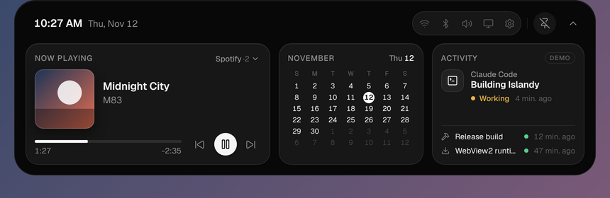
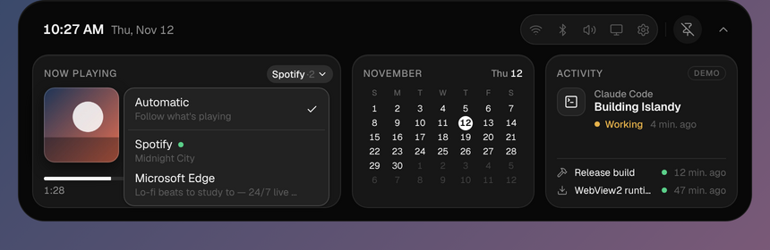
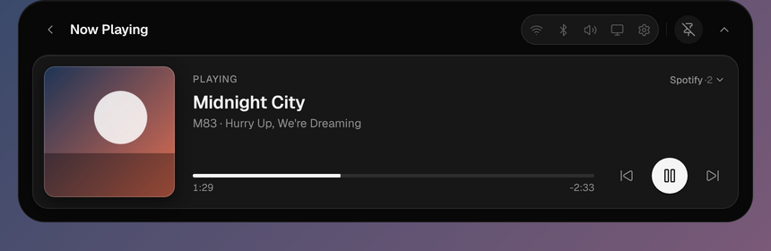

# Media integration (Phase 2)

Islandy shows and controls whatever is playing in any app that publishes a Windows media
session — the same sessions that appear in the volume flyout / media overlay. It uses only the
public **Global System Media Transport Controls (GSMTC)** API: no app-specific APIs, no
accounts, no network, no administrator rights.

| Collapsed (playing)                                                     | Track-change peek                               |
| ----------------------------------------------------------------------- | ----------------------------------------------- |
|  |  |





_Screenshots come from the frontend in a browser with injected snapshots (see "Debugging"),
not from a Windows desktop; the artwork is generated._

## Which apps work

Any app that registers with `SystemMediaTransportControls` works in principle: Chromium and
Firefox browsers (per tab/page with media), Spotify, the Windows Media Player and Groove apps,
VLC (when its SMTC option is enabled), foobar2000 with a plugin, and so on. What Islandy can
show and do is **exactly what the app publishes**:

- Some apps publish no artwork, no album, or no timeline (live streams, many web players).
- Some apps leave controls disabled (e.g. no "previous" on the first track, no seeking).
- Some apps update their timeline rarely or not at all; Islandy interpolates, see below.
- Apps that don't integrate with SMTC are invisible to Islandy (and to Windows' own overlay).

A missing capability is the app's choice, not an Islandy failure. Islandy shows "Unknown
track" for a missing title, falls back to the album artist and then the app's name for the
subtitle, disables unsupported buttons (with a tooltip saying so), and hides seeking. It never
invents metadata.

## Architecture

```
WinRT event handlers ─ NativeEvent ─┐
  (any thread, do nothing else)     ▼
                     ┌──── worker thread "islandy-media" (MTA) ─────┐
Tauri commands ──────►  Backend (GSMTC)  → MediaState → publish()   │
 (async; never block │  timeouts on every WinRT call      │         │
  the main thread)   └────────────────────────────────────┼─────────┘
                                                          ▼
                                MediaHub: latest snapshot + artwork cache
                                                          │ Tauri Channel
                                                          ▼
                     media-store.ts (revision guard) → components
```

Rust (`src-tauri/src/services/media/`):

| Module        | Role                                                                                  |
| ------------- | ------------------------------------------------------------------------------------- |
| `models.rs`   | IPC types (`MediaSnapshot`, `MediaSession`, …), mirrored in `src/services/types.ts`   |
| `metadata.rs` | Text cleanup (whitespace, control characters, 300-char cap), app display names        |
| `playback.rs` | Status mapping, playback rate, timeline normalization, action resolution, seek bounds |
| `state.rs`    | Tracked sessions, **selection policy**, revisioned and de-duplicated snapshots        |
| `identity.rs` | Maps native session objects to stable Islandy ids                                     |
| `artwork.rs`  | Content keys, size limits, data URLs, bounded LRU cache                               |
| `events.rs`   | `NativeEvent` kinds and `MediaHub` (UI channel, latest snapshot, artwork)             |
| `worker.rs`   | Worker loop: event coalescing, request handling, connect retry; the `Backend` trait   |
| `windows.rs`  | The GSMTC `Backend` (Windows only)                                                    |

Everything except `windows.rs` is platform-independent and unit-tested (including the worker,
against a fake backend). On non-Windows hosts the worker reports `unsupported`.

### Threading

- The worker joins the multithreaded COM apartment (`CoInitializeEx(COINIT_MULTITHREADED)`) and
  owns the session manager and every session object; no WinRT object is moved to another
  thread by Islandy. Async results (some are non-`Send` interfaces such as `IBuffer`) are
  fetched with `GetResults()` on the worker after a completion signal.
- Every WinRT async call has a timeout (2 s queries, 3 s controls, 5 s manager) and is cancelled
  on expiry, so an unresponsive app cannot stall the worker.
- WinRT event handlers only post a small message to the worker.
- Tauri commands that reach the worker are `async` and wait on a blocking-pool thread (8 s
  cap), so the UI thread is never blocked.

### Native APIs

| Need      | API (`Windows.Media.Control`, `windows` 0.62)                                                                                                                 |
| --------- | ------------------------------------------------------------------------------------------------------------------------------------------------------------- |
| Manager   | `GlobalSystemMediaTransportControlsSessionManager::RequestAsync`                                                                                              |
| Sessions  | `GetSessions`, `GetCurrentSession`; events `SessionsChanged`, `CurrentSessionChanged`                                                                         |
| Metadata  | `TryGetMediaPropertiesAsync` → `Title`, `Artist`, `AlbumTitle`, `AlbumArtist`, `TrackNumber`, `Thumbnail`; `MediaPropertiesChanged`                           |
| Playback  | `GetPlaybackInfo` → `PlaybackStatus`, `PlaybackRate`, `Controls.Is*Enabled`; `PlaybackInfoChanged`                                                            |
| Timeline  | `GetTimelineProperties` → `StartTime`, `EndTime`, `Position`, `LastUpdatedTime`; `TimelinePropertiesChanged`                                                  |
| Controls  | `TryPlayAsync`, `TryPauseAsync`, `TryTogglePlayPauseAsync`, `TrySkipNextAsync`, `TrySkipPreviousAsync`, `TryChangePlaybackPositionAsync`                      |
| Artwork   | `IRandomAccessStreamReference::OpenReadAsync` (`Windows.Storage.Streams`); `BitmapDecoder` / `BitmapTransform` / `BitmapEncoder` (`Windows.Graphics.Imaging`) |
| App names | `Windows.ApplicationModel.AppInfo::GetFromAppUserModelId` (packaged apps), else a generic AUMID heuristic                                                     |

All event registrations are removed (`Remove*` with their tokens) when a session disappears,
when a native object is replaced, and on quit (`RunEvent::Exit` → `MediaService::shutdown`,
bounded to 500 ms).

## Session discovery and identity

`GetSessions()` returns new projection objects each time, and an app id (AUMID) is **not** a
session id: a browser can expose several sessions under one AUMID. Islandy allocates its own ids
(`"s1"`, `"s2"`, …, never reused) and maps native objects to them by **COM identity** (the
`IUnknown` pointer, stable while Islandy holds a reference). Only if an object's identity
changed is a match on the AUMID accepted, and only when it is unambiguous on both sides.
Unmatched objects are new sessions; unmatched ids are removed sessions.

## Selection policy

Evaluated after every change, in this order (`state::choose_session`):

1. The session the **user picked** in the switcher, while it exists.
2. The session **Windows designates as current**.
3. The most recently **started playing** session.
4. The previous automatic choice, while it exists (stability).
5. The most recently active session; then the first one.

The user's choice is kept until that session disappears or they pick another one (or
"Automatic"). Metadata or timeline events never change the inputs of this policy, so they
cannot make the selection jump.

## Events, coalescing and ordering

- The first native event opens a 60 ms window. Every event in it is folded into one re-read
  per session and part (metadata / playback / timeline); a burst of 50 events costs one read
  (tested).
- A snapshot is published only if it **differs** from the last one. Timeline updates that
  match what the UI already interpolates (within 1.5 s) are not published, so apps that report
  their position every second do not cause IPC or React traffic.
- Every snapshot carries a strictly increasing `revision`. The UI ignores anything not newer,
  so a late command response can never overwrite newer state, including a newer selection.

## Playback controls

`media_control(sessionId, action)` with `action` ∈ `play | pause | togglePlayPause | next |
previous`, and `media_seek(sessionId, positionMs)`:

1. The session id is validated (`"s<digits>"`, must exist) and the action is checked against
   the controls the app currently enables. A toggle falls back to play/pause when the app
   lacks toggling.
2. The GSMTC `Try*Async` call runs on the worker. `false` → `rejected`; timeout → `timeout`.
3. The command's **effect is never faked**: the UI keeps showing the reported state; the play
   button flips only when Windows reports the new status. The worker re-reads playback and
   timeline 250 ms later in case the app sends no event.
4. While a command is in flight the session is `pending`: repeated presses are ignored and the
   button shows a busy state.

Failures surface as a short neutral notice in the widget ("Spotify didn't respond to that");
technical details are logged locally only.

## Timeline

Rust converts WinRT ticks to milliseconds relative to `StartTime`, clamps to the duration, and
converts `LastUpdatedTime` to Unix ms (missing or future timestamps become "now"). The UI
interpolates `position + (now − updatedAt) × rate` **only while playing**, clamps to
`[0, duration]`, and ticks once per second **only while a media view is visible**. Unknown
durations show "Live"/"--:--" and disable seeking. After a seek, the target position is shown
until the next native timeline update (or 3 s), then the native value wins.

## Artwork

1. The thumbnail stream is read (refused above 8 MB) and hashed → `artworkKey`.
2. If the key is not cached, it is decoded with WIC (refused above 8192 px), scaled to ≤ 256 px,
   re-encoded as JPEG (≤ 256 KB), and stored as a `data:image/jpeg` URL in a 12-entry LRU
   cache. Known keys are never decoded again.
3. Snapshots carry only the key; the UI fetches the URL with `get_media_artwork(key)` once, and
   keeps it only while a session references it. Artwork from a previous track or session can
   therefore never be shown for the current one.

Why data URLs: the CSP already allows `img-src data:`; nothing is written to disk; no custom
protocol or file access is needed. The trade-offs (base64 overhead, the URL living in the
WebView's memory) are bounded by the size and cache limits above. Artwork never touches the
filesystem and nothing is fetched from the network.

## IPC surface

| Command                | Returns          | Notes                                                        |
| ---------------------- | ---------------- | ------------------------------------------------------------ |
| `connect_media`        | `MediaSnapshot`  | Registers the UI channel and returns the snapshot atomically |
| `get_media_snapshot`   | `MediaSnapshot`  | Latest published snapshot                                    |
| `select_media_session` | `MediaSnapshot`  | `sessionId: null` returns to automatic selection             |
| `media_control`        | `MediaSnapshot`  | Effect arrives later through the channel                     |
| `media_seek`           | `MediaSnapshot`  | Finite, ≥ 0; clamped to the duration                         |
| `get_media_artwork`    | `string \| null` | Key format validated                                         |

Errors are `{ kind, message }` with `kind` ∈ `unavailable | unsupported | notFound | rejected |
timeout | platform | invalid`. If Windows media sessions can't be reached, the status is
`unavailable` and connecting is retried with exponential backoff (5 s → 5 min).

## Frontend

- `features/media/media-store.ts`: the only media state; started once from
  `useNativeBridge` (idempotent, so React Strict Mode can't create duplicate listeners).
  Independent of the island's expansion state.
- `features/media/media-model.ts`: pure helpers (selection, interpolation, capabilities, seek
  validation, peek decisions, error wording).
- `components/widgets/MediaWidget.tsx` (widget + detail, all UI states),
  `SessionSwitcher.tsx`, `Artwork.tsx`, `useMediaPosition.ts`; `CollapsedIsland` and
  `PeekIsland` show the artwork and playback indicator.
- A **peek** appears when the selected session starts a different track while playing
  (including music starting when nothing was playing). Pause/resume, metadata refreshes and
  the first snapshot after launch never peek, and peeks never interrupt the open dashboard.
- The collapsed bars are a playback-state animation, **not** an audio visualization, and stop
  when paused or with reduced motion.

## Debugging media detection

1. Does Windows see it? Press a media key or open the volume flyout (Win + A on Windows 11):
   if the app's media card isn't there, the app publishes no session and Islandy can't see it.
2. Run `pnpm tauri dev` and watch the terminal: debug builds log every published snapshot
   (`[islandy] media snapshot r12 (Ready, 2 sessions, selected Some("s3"))`), failed requests,
   and native errors (`[islandy] media: …` with the HRESULT).
3. In the WebView DevTools, `window.__islandy.media.getState()` shows the store (dev builds).
4. Without Windows, preview UI states in `pnpm dev` by injecting snapshots:
   `__islandy.media.setState({ connection: "connected" })`, then
   `__islandy.media.getState().applySnapshot({ revision: 1, status: "ready", sessions: […],
selectedSessionId: "s1", selectionMode: "auto" })`.

## Known limitations

- **Not yet verified on Windows at runtime.** The backend compiles and passes clippy for
  `x86_64-pc-windows-msvc`, a Windows build cross-compiles, and all platform-independent logic
  is tested, but no real media session has been exercised (see docs/windows-verification.md).
- Behavior with specific apps (timeline update frequency, artwork timing, AUMIDs) is unknown
  until tested; app names for unpackaged apps come from a heuristic on the AUMID ("Spotify.exe"
  → "Spotify"; opaque hash ids → "Media app").
- No shuffle/repeat, volume, or audio-reactive visualization (volume is Phase 3; a real
  visualizer would need an audio capture pipeline).
- Artwork with EXIF rotation is shown unrotated (album art rarely carries rotation).
- The session switcher lists sessions by app name and title; two tabs of one browser with the
  same title are indistinguishable except by order.
